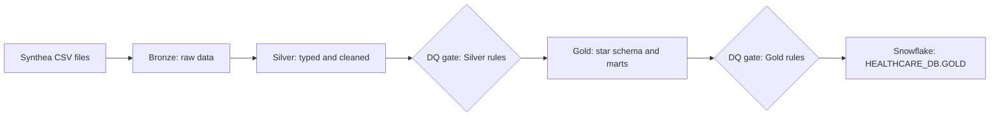

# Healthcare Data Engineering Platform

End-to-end healthcare data pipeline built on **synthetic data only** (generated with Synthea, no real patient data).
Databricks (PySpark, Delta Lake) builds Bronze / Silver / Gold layers, a data-quality gate protects each stage,
Snowflake serves the Gold layer, and Airflow orchestrates the whole run.

## Architecture

Airflow runs these steps as one DAG (`airflow/dags/healthcare_pipeline.py`). If a quality gate fails,
everything after it is skipped and Snowflake keeps the last good data.

## Tech stack

| Area | Technology |
|---|---|
| Processing | Databricks Free Edition (serverless), PySpark, Delta Lake, Unity Catalog |
| Serving | Snowflake (SQL), key-pair authentication |
| Orchestration | Apache Airflow 3.3.2 (runs locally in WSL2) |
| Data quality | Rules as data, severity error / warn, results stored in Delta |
| Testing and CI | pytest, GitHub Actions |
| Language | Python, SQL |

## Pipeline layers

| Layer | Code | What it does |
|---|---|---|
| Bronze | `databricks/bronze/01_bronze_ingest.py` | Loads the 18 raw Synthea CSV files as they are: every column as STRING, plus audit columns `_source_file` and `_ingested_at`. Tables are rebuilt on every run (overwrite), so a re-run gives the same result. |
| Silver | `databricks/silver/02_silver_core_tables.py` | Config-driven build: safe type casting (`try_cast`), identifiers kept as text, money as `DECIMAL(18,2)`, PII columns (SSN, driver's licence, passport) dropped, lower-case column names. |
| Data quality | `databricks/silver/03_data_quality.py` | Runs the rule sets for Silver and Gold (see below). |
| Gold | `databricks/gold/04_gold_star.py` | Star schema: `dim_patient`, `dim_provider`, `dim_payer`, `fact_encounter`, plus marts `mart_patient_360`, `mart_provider_utilization`, `mart_payer_costs`. |
| Serving | `databricks/gold/05_snowflake_load.py`, `snowflake/ddl/01_gold_tables.sql` | Loads the 7 Gold tables into `HEALTHCARE_DB.GOLD` in Snowflake (bulk load, truncate and reload) and checks that row counts match Databricks. |

Data volume: Synthea seed 12345, 123 patients, 5,599 encounters. The data is small on purpose, because the focus is the engineering, not the volume.

## Data quality gate

- Rules are **data**, not scattered code: each rule is a table name, a rule name, a severity and a SQL query that counts bad rows.
- Severity `error` stops the pipeline. The job fails, and every later task is skipped. Severity `warn` is only logged.
- Every run appends its results to `workspace.dq.dq_results`, so quality can be tracked over time.
- 53 rules in total: 32 on Silver and 21 on Gold. A notebook widget (`stage`: silver, gold or all) selects which set runs, so Silver rules run before Gold is built and Gold rules run after.
- **Tested on purpose:** a deliberately failing `error` rule turned the Silver quality task red, skipped the Gold build and the Snowflake load, and left Snowflake unchanged. After the rule was removed, clearing the failed task recovered the run.

## Design decisions

- **Airflow owns the order and the retries.** Each of the five Databricks jobs has job-level retries switched off, so every attempt shows up as its own try in Airflow. Quality tasks have `retries=0` (a failed quality rule is a data problem, not a temporary fault); the other tasks retry once after 2 minutes.
- **Re-runs are safe (idempotent).** Bronze is rebuilt with overwrite and the Snowflake load truncates and reloads, so running a task twice creates no duplicates and gives the same data (`age_years` depends on the build date).
- **Quality failures stop the line.** Downstream tasks are skipped (`upstream_failed`), so Snowflake always holds the last good load.
- **Manual trigger on purpose.** The input is static synthetic data, and the Free Edition has a daily compute quota, so a schedule would only rebuild identical tables. In production this DAG would run on a schedule or be triggered when new files arrive.
- **Secrets stay out of the repo.** Snowflake uses key-pair authentication; the key and passphrase live in a Databricks secret scope. The Databricks token used by Airflow lives in an environment variable on the machine that runs Airflow. `.gitignore` blocks private key files.
- **Snowflake load check.** Row counts, totals, timestamp ranges and column types are compared after the load. Counts alone missed a timestamp type bug during development, so `use_logical_type=True` is set in the loader.
- **Lesson learned.** A leftover exploration cell in the Bronze notebook (`VERSION AS OF 0`) stopped working once Delta's file-retention period passed and broke the scheduled job. Job notebooks now contain only pipeline code.

## How to run

1. **Data:** generate Synthea CSV files (this project used seed 12345) and upload them to the Unity Catalog volume `workspace.bronze.raw_synthea`.
2. **Databricks:** import the notebooks from `databricks/` and create one serverless job per notebook (`hc_bronze_ingest`, `hc_silver`, `hc_dq`, `hc_gold`, `hc_snowflake_load`), with no schedule and no job-level retries. The `hc_dq` notebook reads a `stage` parameter, which the DAG sets to `silver` or `gold`.

3. **Snowflake:** create a warehouse, a database, a role and a service user with key-pair authentication. Store the private key, its passphrase and the account identifier in a Databricks secret scope named `snowflake_loader`. The loader creates the Gold tables with `CREATE TABLE IF NOT EXISTS`; the generated DDL is also saved in `snowflake/ddl/01_gold_tables.sql`.
4. **Airflow:** in a Python 3.12 virtual environment, install Airflow 3.3.2 using Airflow's constraints file, then the Databricks provider. Provide the Databricks connection as the environment variable `AIRFLOW_CONN_DATABRICKS_DEFAULT` (workspace host and a personal access token). Put your own job ids in `JOB_IDS` in the DAG file, start Airflow with `airflow standalone` (development use only), and trigger `healthcare_pipeline`.
5. **Tests:** `pip install pytest`, then `python -m pytest tests`. CI runs the same tests on every push.

## Limits and known gaps

- Databricks Free Edition: serverless compute only, a daily compute quota, at most 5 concurrent job tasks, restricted outbound internet, no commercial use.
- Airflow runs locally (`airflow standalone` is meant for development). A production setup would use a managed or containerised Airflow and a secrets backend.
- The Databricks token used by Airflow expires after 30 days and must be renewed.
- Bad rows are reported by the quality gate but not yet moved into a quarantine table (roadmap).
- Tests cover the DAG structure only; unit tests for the Silver and loader logic are on the roadmap.

## Documentation

- [Data dictionary](docs/data_dictionary.md): Gold tables, columns, grain and business rules.
