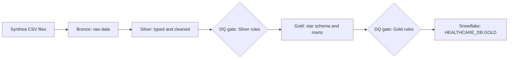

# Healthcare Data Engineering Platform

End-to-end healthcare data pipeline built on **synthetic data only** (generated with Synthea, no real patient data).
Databricks (PySpark, Delta Lake) builds Bronze / Silver / Gold layers, a data-quality gate protects each stage,
Snowflake serves the Gold layer, and Airflow orchestrates the whole run.

## Architecture

Airflow runs these steps as one DAG (`airflow/dags/healthcare_pipeline.py`). If a quality gate fails,
everything after it is skipped and Snowflake keeps the last good data.

## Tech stack

| Area | Technology |
|---|---|
| Processing | Databricks Free Edition (serverless), PySpark, Delta Lake, Unity Catalog |
| Serving | Snowflake (SQL), key-pair authentication |
| Orchestration | Apache Airflow 3.3.2 (runs locally in WSL2) |
| Data quality | Rules as data, severity error / warn, results stored in Delta |
| Testing and CI | pytest, GitHub Actions |
| Language | Python, SQL |

## Pipeline layers

| Layer | Code | What it does |
|---|---|---|
| Bronze | `databricks/bronze/01_bronze_ingest.py` | Loads the 18 raw Synthea CSV files as they are: every column as STRING, plus audit columns `_source_file` and `_ingested_at`. Tables are rebuilt on every run (overwrite), so a re-run gives the same result. |
| Silver | `databricks/silver/02_silver_core_tables.py` | Config-driven build: safe type casting (`try_cast`), identifiers kept as text, money as `DECIMAL(18,2)`, PII columns (SSN, driver's licence, passport) dropped, lower-case column names. |
| Data quality | `databricks/silver/03_data_quality.py` | Runs the rule sets for Silver and Gold (see below). |
| Gold | `databricks/gold/04_gold_star.py` | Star schema: `dim_patient`, `dim_provider`, `dim_payer`, `fact_encounter`, plus marts `mart_patient_360`, `mart_provider_utilization`, `mart_payer_costs`. |
| Serving | `databricks/gold/05_snowflake_load.py`, `snowflake/ddl/01_gold_tables.sql` | Loads the 7 Gold tables into `HEALTHCARE_DB.GOLD` in Snowflake (bulk load, truncate and reload) and checks that row counts match Databricks. |

Data volume: Synthea seed 12345, 123 patients, 5,599 encounters. The data is small on purpose, because the focus is the engineering, not the volume.

## Data quality gate

- Rules are **data**, not scattered code: each rule is a table name, a rule name, a severity and a SQL query that counts bad rows.
- Severity `error` stops the pipeline. The job fails, and every later task is skipped. Severity `warn` is only logged.
- Every run appends its results to `workspace.dq.dq_results`, so quality can be tracked over time.
- 53 rules in total: 32 on Silver and 21 on Gold. A notebook widget (`stage`: silver, gold or all) selects which set runs, so Silver rules run before Gold is built and Gold rules run after.
- **Tested on purpose:** a deliberately failing `error` rule turned the Silver quality task red, skipped the Gold build and the Snowflake load, and left Snowflake unchanged. After the rule was removed, clearing the failed task recovered the run.
