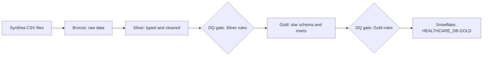

# Healthcare Data Engineering Platform

End-to-end healthcare data pipeline built on **synthetic data only** (generated with Synthea, no real patient data).
Databricks (PySpark, Delta Lake) builds Bronze / Silver / Gold layers, a data-quality gate protects each stage,
Snowflake serves the Gold layer, and Airflow orchestrates the whole run.

## Architecture

Airflow runs these steps as one DAG (`airflow/dags/healthcare_pipeline.py`). If a quality gate fails,
everything after it is skipped and Snowflake keeps the last good data.

## Tech stack

| Area | Technology |
|---|---|
| Processing | Databricks Free Edition (serverless), PySpark, Delta Lake, Unity Catalog |
| Serving | Snowflake (SQL), key-pair authentication |
| Orchestration | Apache Airflow 3.3.2 (runs locally in WSL2) |
| Data quality | Rules as data, severity error / warn, results stored in Delta |
| Testing and CI | pytest, GitHub Actions |
| Language | Python, SQL |

Status: core pipeline complete end to end; documentation in progress.
